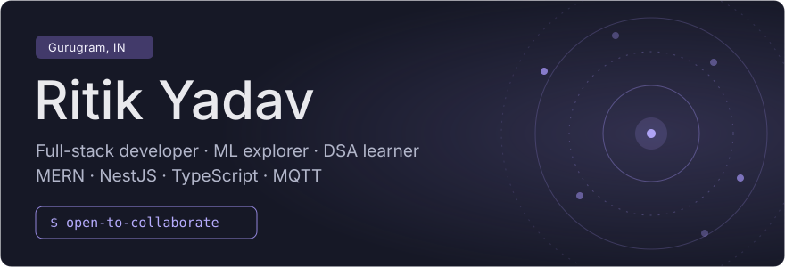
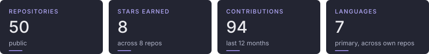
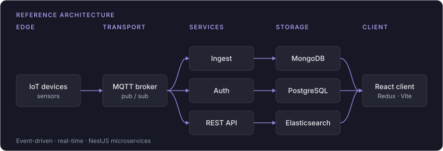
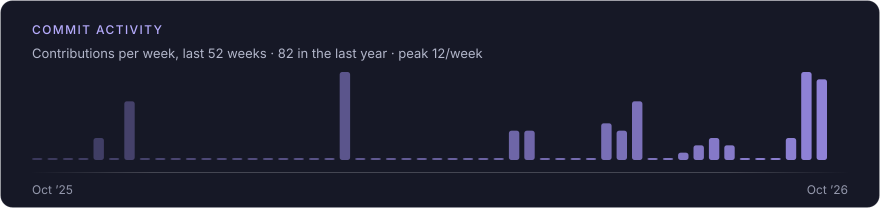
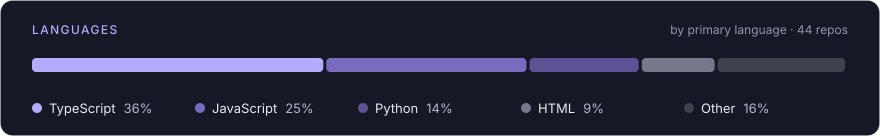

<picture>
  <source media="(prefers-color-scheme: light)" srcset="assets/banner-light.svg">
  
</picture>

<a href="#stack">Stack</a> ·
<a href="#architecture">Architecture</a> ·
<a href="#activity">Activity</a> ·
<a href="#now-learning">Learning</a> ·
<a href="#top-repos">Repos</a> ·
<a href="#contact">Contact</a>

<picture>
  <source media="(prefers-color-scheme: light)" srcset="assets/stats-light.svg">
  
</picture>

Full-stack developer. MERN, NestJS, TypeScript. Exploring ML and LLMs. Building event-driven and IoT systems.

| | |
| --- | --- |
| **Working on** | Full-stack development, data analysis, ML |
| **Collaborate on** | Software dev and ML projects |
| **Ask me about** | Web dev, DSA, ML, software architecture, IoT |
| **Based in** | Gurugram, Haryana |

## Stack

**Languages**

**Frontend**

**Backend**

**Data**

**AI / ML**

**Tooling**

## Architecture

<picture>
  <source media="(prefers-color-scheme: light)" srcset="assets/architecture-light.svg">
  
</picture>

## Activity

<picture>
  <source media="(prefers-color-scheme: light)" srcset="assets/activity-light.svg">
  
</picture>

<picture>
  <source media="(prefers-color-scheme: light)" srcset="assets/languages-light.svg">
  
</picture>

## Now learning

- **MERN stack** — active
- **AI / ML** — active
- **DSA** — ongoing
- **LLMs / Gen AI** — started

## Top repos

| Repository | Description | Language | Stars |
| --- | --- | --- | ---: |
| [ritik-portfolio](https://github.com/Ritikyadav1/ritik-portfolio) | Animated personal portfolio: Next.js, TypeScript, Tailwind and Framer Motion with live GitHub data | TypeScript | 1 |
| [bulk-ip-checker](https://github.com/Ritikyadav1/bulk-ip-checker) | Bulk threat-intel lookups for IPs, URLs and hashes via VirusTotal and AbuseIPDB, with IR-ready reports | TypeScript | 1 |
| [ai-code-security-engineer](https://github.com/Ritikyadav1/ai-code-security-engineer) | AI-assisted code security scanning: static analysis, secrets and dependency checks with a triage workflow | TypeScript | 1 |
| [Universal-safe-archive-analyzer](https://github.com/Ritikyadav1/Universal-safe-archive-analyzer) | Sandboxed Electron app for safely unpacking and analyzing malicious ZIP, TAR and 7z archives | TypeScript | 1 |
| [Travel-website-backend](https://github.com/Ritikyadav1/Travel-website-backend) | NestJS REST API backend for a travel website (user management) | TypeScript | 1 |

## Contact

